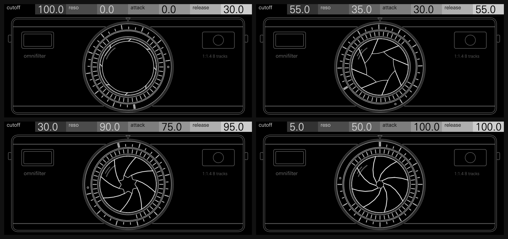
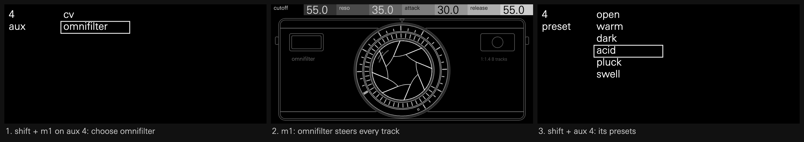
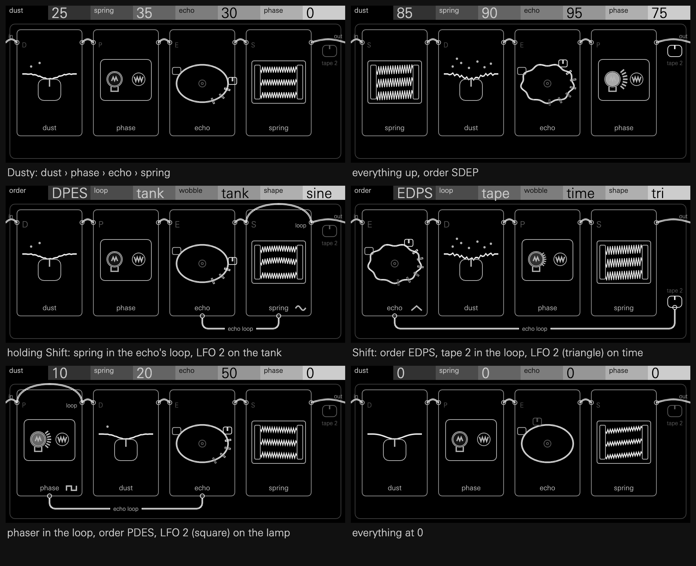
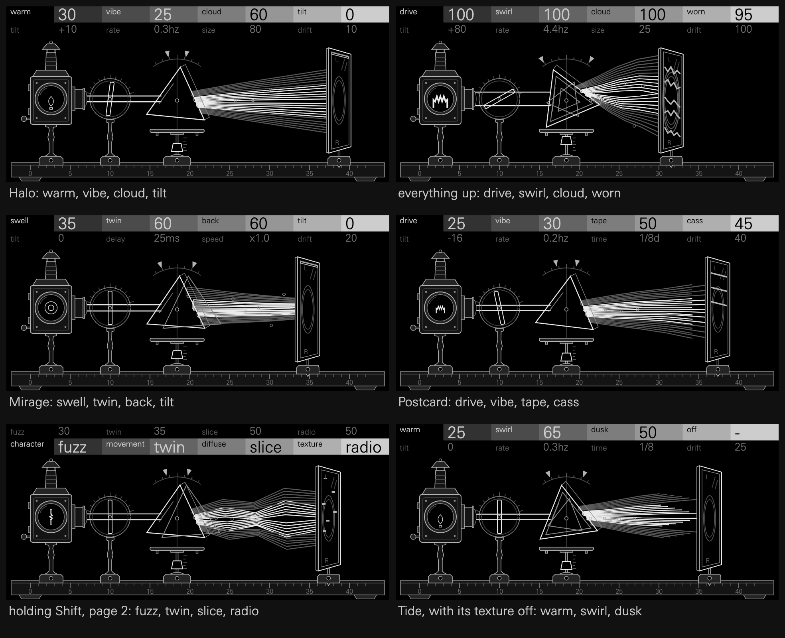

# OP-XY ModFX

Mods and effects for the Teenage Engineering OP-XY, built with the
[Open-XY SDK](https://github.com/etcetc000/open-xy):

- **Omnifilter**, an aux module: a global mod that sits on one of the OP-XY's
  aux tracks instead of an instrument track. It takes no instrument slot, and
  its controls steer every instrument track at once.
- **Lint**, a send effect: a 1970s box of effects on FX I or II, with its own
  page on the send.
- **Chroma**, a send effect: an ethereal stereo console of four modules on FX I
  or II. See [chroma/README.md](chroma/README.md).



## Omnifilter

One filter and one envelope for the whole OP-XY. Omnifilter's four controls
set cutoff, resonance, attack and release on all eight instrument tracks. Each
setting is stored on every track exactly as if that track's own encoder had
been turned. Because the controls belong to an aux track, they can also be
locked on steps, so the whole mix opens and closes with the pattern.

**Controls:** cutoff, reso, attack, release

**Presets:** open, warm, dark, acid, pluck, swell

**The screen** is the front of a rangefinder camera, and its lens is the
filter every track plays through. The iris has eight blades, one per track:
- **cutoff** opens and closes the iris.
- **resonance** sharpens the opening from a circle into an eight-pointed star.
- **attack** turns the knurled focus ring.
- **release** turns the engraved scale ring under the index mark.

Nothing moves unless a control does.

### Using it



An aux track takes Omnifilter the way an instrument track takes an engine:

1. Select an aux track (aux 1 to 6), hold **Shift** and press **M1**.
2. Choose `omnifilter` from the list, titled "aux" under the track's number.
3. Press **M1** to see its page, and turn the encoders.
4. Hold **Shift** and press the track's key for its presets: open, warm,
   dark, acid, pluck and swell. A preset moves all eight tracks at once.

To put the track's own module back, choose it from the same Shift and M1 list
(`brain`, `punch-in`, `midi`, `cv`, `audio` or `tape`).

### How a module shares its track

- **Saved with the project.** The aux track keeps Omnifilter the way an
  instrument track keeps its engine, so it's still there after a restart.
- **MIDI and CV play on.** On aux 3 (MIDI) or aux 4 (CV), the track's own
  notes still go to your external gear, and its M2 and M3 CCs still go out.
  Turning Omnifilter sends no CC.
- **The other stock modules go quiet.** On aux 1, 2, 5 and 6 (brain, punch-in,
  audio, tape), the track's own notes start nothing, and the brain transposes
  no routed track, since their controls are hidden behind Omnifilter's page.
- M2 to M4 stay the track's stock pages.

The screen's artwork and the iris's tables come from
[`omnifilter/tools/make_panel.py`](omnifilter/tools/make_panel.py); rerun it
after changing a shape.

## Lint



A 1970s effects box for a send, after Finegear's Dust Collector: two tape
saturations, an optical phaser, a gritty PT2399-style echo and a three-spring
tank. They run in any of six orders, one of them can be patched into the
echo's feedback loop, and two LFOs move them.

**Controls:** dust, phase, echo, spring; press for tape 2, rate, time, tone;
hold Shift for order, shape, loop, wobble

**Named presets:** Dusty, Tank, Slapback, Swoosh, Runaway, Crushed. A send effect
can't ship presets, so these appear in the SDK's browser preview and not on the
OP-XY.

**The screen** is a 1970s effects chassis with its lid off, seen from above: its
four sections as modules in the chosen order, joined by one patch cable from in to
out. Each control moves a part of its module. [`lint/README.md`](lint/README.md) says how.

**CPU,** measured on an OP-XY at v1.8.0: 5.40% of the block budget at its default
settings.

Put Lint on a send with **Shift** and **M1** on FX I or II. At full send a
track goes wholly through the box, as it would through the hardware inline;
less send blends the clean track with it.

## Chroma



An ethereal stereo console for a send, after Hologram's Chroma Console: four
modules in a row, 22 effects between them, each module running one of its own or
none. Most voices reach a send in the centre, so each module that can parts left
and right, and a mono source leaves wide. It's built from the pedal's manual, as
no pedal has been measured, so it follows what the manual describes and not the
pedal's own sound.

**Controls:** character, movement, diffuse, texture; press for tilt, rate, time,
drift; hold Shift for each module's effect

**The screen** is a Victorian optical bench from the side, left to right as the
sound goes: a magic lantern, a glass plate in a ring, a rocking prism, its light
fanning out, and a ground-glass screen on a rail. Each control moves its own part.
[`chroma/README.md`](chroma/README.md) says how, and lists all 22 effects.

Put Chroma on a send with **Shift** and **M1** on FX I or II. A new project starts
on warm, vibe, cloud and tilt. At full send a track goes wholly through it; less
send blends the clean track with it.

**Recipes:** a send effect can't ship presets, so these don't appear in a browser
on the OP-XY. Choose the effects with Shift, and turn the controls to what the
header shows:

| Recipe | Effects | Page 1 | Page 2 |
| --- | --- | --- | --- |
| Halo | warm, vibe, cloud, tilt | 30, 25, 60, 0 | +10, 0.3hz, 80, 10 |
| Aurora | warm, pitch, cloud, tilt | 20, 35, 70, +24 | +20, +11, 90, 15 |
| Mirage | swell, twin, back, tilt | 35, 60, 60, 0 | 0, 25ms, x1.0, 20 |
| Tide | warm, swirl, dusk, off | 25, 65, 50, - | 0, 0.3hz, 1/8, 25 |
| Postcard | drive, vibe, tape, cass | 25, 30, 50, 45 | -16, 0.2hz, 1/8d, 40 |
| Mosaic | warm, twin, slice, tilt | 20, 40, 60, -10 | 0, 33ms, .19s, 45 |
| Static | fuzz, trem, cloud, radio | 20, 40, 45, 30 | -10, 0.8hz, 70, 20 |

**CPU,** measured on an OP-XY at v1.7.0: 7.31% of the block budget on the default
effects, and 10.91% on howl, swirl, cloud and cass with every control at full. That
heaviest setting is enough that a busy project may drop audio, though no one has
heard it do so yet.

## Status: experimental

Each machine needs SDK changes still in review, and builds against its own
branch until they merge:

- **Omnifilter** needs aux modules (SDK 1.8),
  [etcetc000/open-xy#221](https://github.com/etcetc000/open-xy/pull/221):
  branch `sdk/aux-modules`.
- **Lint** needs effect pages, shift rows and effect screens (SDK 1.7),
  [etcetc000/open-xy#230](https://github.com/etcetc000/open-xy/pull/230):
  branch `sdk/effect-screens`.
- **Chroma** needs the same (SDK 1.7), on the same branch.

```bash
git clone -b sdk/effect-screens https://github.com/mmockett/open-xy
```

```bash
python open-xy/sdk.py test --machine OP-XY-ModFX/lint
```

```bash
python open-xy/sdk.py build --machine OP-XY-ModFX/lint --machine <a synth> --stock-os <stock-1.2.1>/os.ldr --out <builds>/lint-001
```

For Chroma, pass `OP-XY-ModFX/chroma` instead. For Omnifilter, clone `sdk/aux-modules`
and pass `OP-XY-ModFX/omnifilter`.
A firmware needs at least one synth. It runs on an OP-XY with **OS 1.2.1**; installing
it is described in the SDK's
[building firmware](https://github.com/etcetc000/open-xy/blob/staging/docs/build.md#5-install)
guide.

Each release's CPU cost, measured on an OP-XY with `sdk.py profile benchmark`
over three runs, is recorded with its entry in the
[Open-XY catalog](https://github.com/etcetc000/open-xy/blob/staging/catalog/machines.json).

## Licence

MIT
