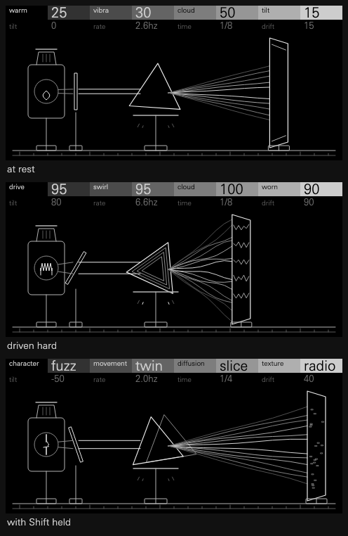
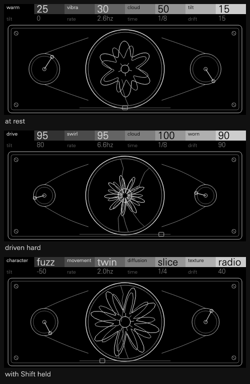
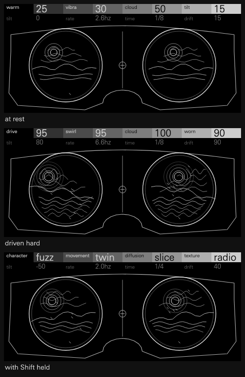
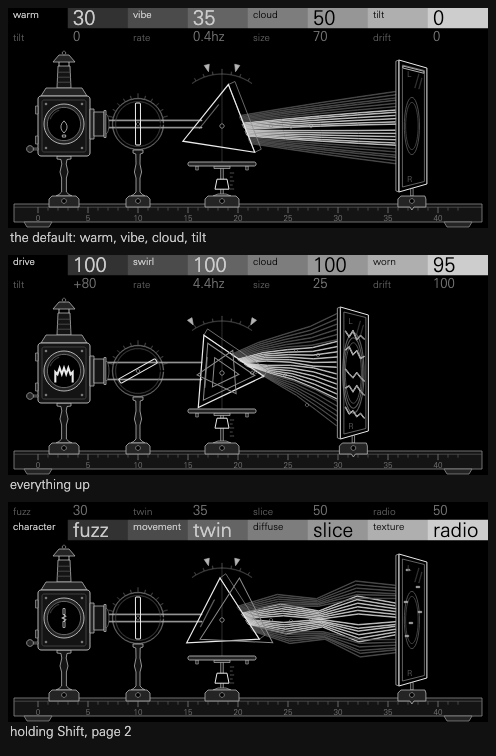

# Chroma's screen: three directions

Three directions were drawn at the device's 480 x 220, with the real two-page
header in the device's font, and judged at 1:1. Each sheet shows the same three
states: at rest, driven hard, and with Shift held. `tools/mockup.py` draws them.

The brief: ethereal, rich in stereo, distinct from Lint, and within the house
rules: monochrome, one real nostalgic object filling the screen, fine outlines,
every control changing a physical part.

Lint is a box seen from above, with four bays on a patch cable. So none of these
use bays, cables or a top-down view.

**Chosen: A, the optical bench.** B is the one to go back to if A's look tires.

## A: the optical bench (chosen)

A Victorian optics experiment, side on, on a rail: a lamp, a card, a prism, its
light fanning out, and a screen that catches it. Light dispersing is what the
sound does, and the name says colour on a screen that has none.

| Control | The part it moves |
| --- | --- |
| Character Amount | The flame grows and the beam widens |
| Tilt | The card in front of the lamp turns |
| Movement Amount | The prism's stops open, and it rocks that far |
| Rate | The weight slides up the stem, as on a metronome |
| Diffuse Amount | The fan of rays opens |
| Time | The screen slides along the rail |
| Drift | The rays bend |
| Texture Amount | Blades, lines, cracks or static on the screen |

- **For:** it reads left to right as the signal does, so each of the four modules
  has its own place and the effects can change what's in it. It's the clearest at
  1:1, and it stays calm with everything up.
- **For:** stereo has an obvious picture: upper rays left, lower rays right.
- **Against:** an apparatus can feel more scientific than ethereal. The first
  draft did. The rays also read as wires until they were pulled into a true fan.
- **Against:** a prism and rays can bring a certain album cover to mind.

## B: the chromatrope

A real Victorian lantern slide from which the name could come: two painted glass
discs in a mahogany frame, turned against each other by a crank, throwing moving
rosettes. Counter-rotation stands for left and right.

- **For:** the most on-name and the most beautiful centre. It's the most purely
  ethereal of the three.
- **Against:** four modules and twenty effects have only one place to go, so most
  controls would change the same rosette, and it would be hard to read which did
  what. That breaks "every control must read".
- **Against:** overlapping rosettes are the "too many overlapping vectors" Ghost
  was marked down for, and rotating them would cost more redrawing on the device.
- **Against:** a wide frame around a circle leaves its sides nearly empty.

## C: the stereoscope

A Holmes stereoscope's hood with its two lenses, each showing one channel's view
of a moonlit lake. The difference between the views is the stereo width.

- **For:** the most direct picture of stereo, and a lovely real object.
- **Against:** at 1:1 it reads as a pair of goggles.
- **Against:** the scene is a small landscape drawn twice, which is cluttered at
  this size, doubles the node count, and looks muddled when driven.
- **Against:** moons and lakes are decoration: nothing in them says what a
  control does to the sound.

## What changed from A's mockup to the build

- The rays became a true fan from a narrow slit, with the outer ones dimmer.
- Dust motes drift through the light, more as it opens, and rings of light open on
  the screen. These answered "too scientific".
- The prism's stops moved above it, clear of the stem's metronome weight.

The second pass made it more of a real instrument, without changing what any
control moves:

- A magic lantern with its chimney, door and stepped lens, in place of a plain lamp box.
- Turned posts on carriages clamped to a rail engraved in centimetres, so the
  screen's carriage reads off its place. The screen is ground glass in a frame.
- A glass plate in a graduated ring in place of the card, a prism with depth and a
  glint, and a scale on the arc and the stem for the stops and the weight.
- The rays now start on the prism's far face and follow it as it rocks.
- Dark static bodies hide what's behind them, as Wane's do.

Every control at 0, 50 and 100 is in [controls-1x.png](controls-1x.png), and every
effect in [choices-1x.png](choices-1x.png). These come from the real display code
on the host. None of it has been seen on the device yet.
