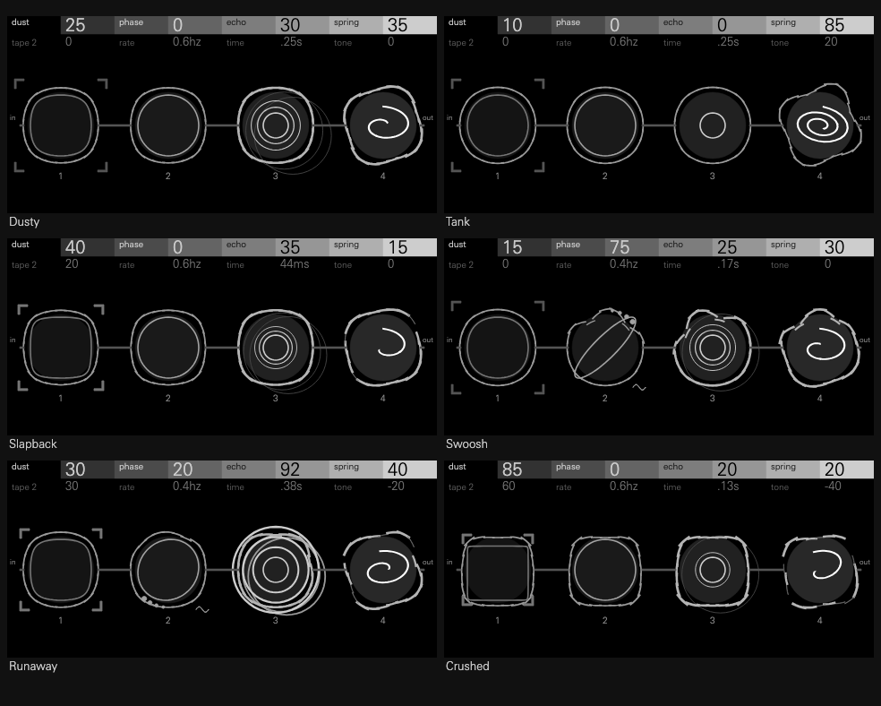

# Lint

A 1970s effects box for an OP-XY send (FX I or II), after Finegear's Dust
Collector: two tape saturations, an optical phaser, a gritty PT2399-style echo
and a three-spring tank. They run in any of six orders, one of them can be
patched into the echo's feedback loop, and two LFOs move them.

| | Encoder 1 | Encoder 2 | Encoder 3 | Encoder 4 |
| --- | --- | --- | --- | --- |
| Page 1 | dust: tape 1, diode types I..V | phase: depth, wet, feedback | echo: wet and feedback; Madness above 85% | spring: drive and wet |
| Page 2 (press) | tape 2: after the chain | rate: LFO 1, 0.17..7.5 Hz | time: 3..650 ms | tone: the tank's tilt |
| Shift | order: DPES, DEPS, PDES, DSPE, SDEP, EDPS | shape: both LFOs (sine, tri, sqr) | loop: what's in the echo's feedback (off, tape, lamp, tank) | wobble: LFO 2's target (off, time, tank, lamp) |

Page 1's encoders follow the default order, DPES, and each control on page 2
and the shift row sits under the section it shapes. Both pages show at once,
page 1 over page 2, as on the two-page synths: a press of any encoder moves the
encoders to the other row, which grows and brightens on the stepped bar.
Holding Shift turns that row into the shift row's choices. The order's letters are
page 1's names: D dust, P phase, E echo, S spring.

**Named presets:** Dusty, Tank, Slapback, Swoosh, Runaway, Crushed. A send effect
can't ship presets, so these appear in the SDK's browser preview and not on the
OP-XY.

## The sections

- **Dust and tape 2** are the hardware's diode saturations. The control sweeps
  five diode pairs, from soft germanium (I) to lopsided silicon against
  germanium (V), and drives them up to 16 times. A head bump lifts the lows
  into them, the top darkens as they drive, and a makeup gain keeps the level.
- **Phase** is an optical phaser. The LFO lights a lamp whose glow, lagging as
  a bulb's does, sweeps four all-passes over 100 Hz to 4 kHz. Its mix reaches
  the deepest notches by a third of the control, with feedback up to 0.7.
- **Echo** is a PT2399-style delay: its loop darkens and its converter coarsens
  as the time grows, and a high-pass keeps the lows from piling up. Above 85%
  the feedback passes 1 (Madness) and runs away from what is played.
- **Spring** is three springs at a quarter rate, each with ten dispersion
  stages for the chirp; tone tilts the tank's bass and treble.

Lint mixes its own dry, as the hardware does, and declares `dryLevel` 0: at
full send a track goes wholly through it.

It works at one level whatever the send's: it lifts its input so the loudest
so far sits near -12 dBFS, and lowers its output as much. Its saturations,
the echo's hiss and converter, and its slow filters then behave alike at any
send level. The lift only ever falls, as louder input arrives, and Lint's
memory falls with it, so nothing it holds jumps in level. Dust and tape 2
fade in from clean over the first quarter of their controls.

## CPU

Measured on an OP-XY at v1.8.0 with `sdk.py profile benchmark`, in one run, with
graphics excluded: 5.40% of the block budget at its default settings. No heavier
setting was measured.

## The screen

Under the two pages, four scopes, one under each encoder, each on a disc in
that encoder's dark step, its trace in that encoder's grey: dark grey, mid grey, light grey and white, as the OP-XY's
encoders and the header's bar run. Each scope traces one cycle of the sound
against itself, so a section that does nothing leaves a plain ring.

- **dust:** the ring squares as the diodes clip, its top flatter than its
  bottom once they lopside. Tape 2's corners close in on it with its level.
- **phase:** the ring leans into an ellipse that breathes as the lamp sweeps
  the all-passes. LFO 1's mark orbits it, its trail wider the faster the rate,
  with its shape beside it.
- **echo:** ripples spread round the ring, spaced by time, as many as the
  feedback holds; past Madness they run out past the scope.
- **spring:** the ring winds into a spiral, more turns the harder the tank is
  driven, leaning with tone.

Each scope's rim carries the chain. It starts as the rim before it in the
chosen order left it and takes its own section's change, so the last rim holds
the whole chain and the order changes what it looks like. Dust squares the rim,
its top pressed flatter once the diodes lopside. Phase cuts two notches into
it where the lamp holds them. Echo doubles it, its copies stepping out behind
its own scope at the echo's time, crowding past Madness. Spring ripples it, tone
tilting the ripple toward the top (treble) or the bottom (bass). Tape 2 wears
the last rim thin, with arcs dropping out. A section in the echo's loop works
on the echo's rim.

A change travels: turn a control and it passes along the order a rim at a
time. As it arrives, dust's rim judders, harder the more it drives; the echo's
copies step out; the spring's rim rings, longer the harder it is driven; tape
2's rim wavers. The lamp walks the notches round the rims at its rate and in
its shape, and LFO 2 moves what it wobbles. Otherwise the screen is still.

Under each scope is its place in the order; a bar joins neighbours the order
runs straight through. A section patched into the echo's loop loses its place,
the loop reaches it from under the echo, and it works on the echo's copies.
LFO 2's mark, in its shape, sits over what it wobbles. Holding Shift lights the
order's bars and enlarges the places. On the shift row, `lamp` is the phaser.
The header captions rate in hertz, time in milliseconds (then seconds from
0.1 s) and tone from -100 to 100.

Lint draws the SDK's two-page header (`opxy/page_header.hpp`) in text slots
0..15 and the order's places in 16..19, so it needs the 32-slot limit an SDK 1.7
display may declare.

`tools/make_panel.py` writes the artwork and `panel.h`, `tools/make_tables.py`
writes `tables.h`, and `tools/mockup.py` drew the first proposal (`mockup.png`).
